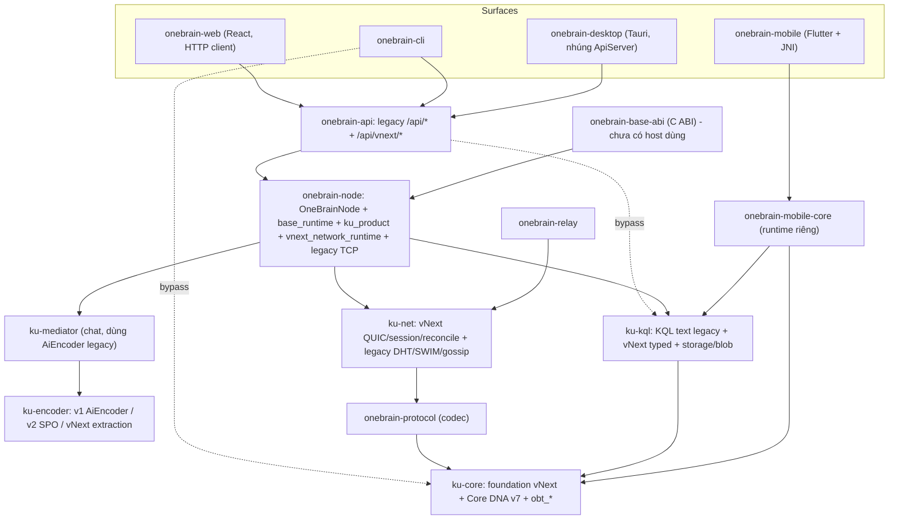

# Đánh giá kiến trúc OneBrain — KU · OBP · KQL · Nền tảng

> Ngày: 18/10/2026 · Repo `main` @ `1f8f5ec` · Đánh giá **read-only** (đọc code/spec, không build/test lại).
> Các phát hiện ⚠️ có đánh dấu **[đã kiểm chứng]** được tôi đọc trực tiếp trong code; phần còn lại tổng hợp từ 4 lượt rà soát song song có trích dẫn file:line.
>
> **Quyết định sau rà soát:** owner chọn ưu tiên lỗi 1–2, mobile dùng chung runtime và giao agent chọn hướng KQL — xem [D-051](../DECISIONS.md#d-051--architecture-review-priorities-shared-mobile-runtime-and-kql-direction). Hàng đợi thực thi nằm ở [MASTER_PLAN — Architecture remediation backlog](../MASTER_PLAN.md#architecture-remediation-backlog-d-051); file này chỉ là bằng chứng/snapshot, không phải kế hoạch.

---

## 0. Kết luận điều hành

| Mảng | Chất lượng thiết kế | Mức hiện thực hóa trong sản phẩm mặc định | Nhận xét một dòng |
|---|---|---|---|
| **Nền tảng vNext** (canonical/CID/feed/vault/runtime) | ★★★★★ | ★★★☆☆ | Bất biến rất chặt; nhưng nằm cạnh 2 thế hệ legacy chưa có lộ trình gỡ |
| **KU** | ★★★★☆ | ★★☆☆☆ | Mô hình SEM phong phú, lưu trữ crash-safe; thực tế chỉ lưu được KU 1 mệnh đề, đường AI chưa “hạ” xuống canonical |
| **OBP** | ★★★★☆ | ★★★☆☆ | Mảng trưởng thành nhất (QUIC thật, session binding, reconciliation có journal); default-off, có lỗi DoS ở relay và listener legacy mở 0.0.0.0 |
| **KQL** | ★★☆☆☆ | ★☆☆☆☆ | Hai hệ thống không liên quan mang chung tên; KQL dạng text có lỗi ngữ nghĩa, ~9k LOC vNext không có consumer |

**Luận điểm chính:** OneBrain có *kỷ luật bất biến* (determinism, consent 2 bước, validate-then-accept, “không claim quá bằng chứng”) ở mức hiếm thấy. Vấn đề không nằm ở chất lượng từng module mà ở **khoảng cách giữa “Complete/Frozen trong spec” và “được nối vào sản phẩm chạy mặc định”**, cộng với **3 thế hệ mô hình cùng tồn tại** (Core DNA v7 → SPO v2 → vNext) mà người dùng phần lớn vẫn chạm vào bản legacy.

---

## 1. Số liệu tổng thể

| Chỉ số | Giá trị |
|---|---|
| Rust workspace | 19 crate thành viên ([Cargo.toml](../../../../src/Cargo.toml)); bot/glasses/extension chỉ có README |
| LOC lớn nhất (đếm dòng không rỗng) | `onebrain-node` ~86k · `ku-core` ~72k · `ku-net` ~31k · `ku-kql` ~25k · `onebrain-mobile*` ~33k · `onebrain-web` ~15k · `onebrain-api` ~15k |
| Tài liệu | 468 file `.md` (~98k dòng, chưa tính archive); `docs/specs/vnext` ~145 file, README index ~110 contract gần như toàn bộ “Complete/Frozen” |
| Validator | [validate_vnext_contracts.py](../../../../scripts/ci/validate_vnext_contracts.py) ~9.000 dòng, ~185 kiểm tra “needle” grep chuỗi trong source |
| Quyết định | D-001…D-050 trong [DECISIONS.md](../DECISIONS.md) |
| Nhịp commit từ 01/10 | 52 commit, **18 commit** chỉ là tinh chỉnh UX/lỗi của luồng share D-045 trên Web |

File lớn nhất (god-module): `vnext_network_runtime.rs` 4.926 · `node.rs` 3.794 · `vnext_distributed_pomv.rs` 3.223 · `base_runtime.rs` 3.177 · `vnext_api.rs` 2.797 · `core_dna.rs` 2.767 · `vnext_product_runtime.rs` 2.674 · `ku_product.rs` 2.232 · `vnext_outbox.rs` 2.184 · `ku-kql/executor.rs` 2.064.

---

## 2. Kiến trúc lớp (thực tế trong code)

**Đúng thiết kế:** Desktop/Web/CLI dùng chung một runtime node (Desktop chỉ ~1,5k LOC glue, nhúng `ApiServer::with_shared_node`). Không có vòng phụ thuộc.
**Lệch thiết kế:**
- API/CLI phụ thuộc thẳng `ku-core`, `ku-kql`, `ku-encoder`, bỏ qua façade node.
- Mobile có runtime riêng (`onebrain-mobile-core`, kể cả archive XChaCha riêng 774 LOC). `onebrain-base-abi` không có host thật nào gọi tới.
- Dữ liệu nằm ở ~30 điểm mở `redb` riêng lẻ, không có miền giao dịch chung.

---

## 3. KU — Knowledge Unit

### 3.1 KU thực chất là gì (vNext)
- **Payload:** `SemanticFrameSet { statements: Vec<StatementFrame> }`. Predicate là CCID 16 byte; argument là `TermRef` (Concept/Variable/Receptor/Statement/Literal). Có qualifier (phủ định, modality, thời gian, địa điểm, perspective) và số lượng hữu tỉ chính xác kèm vector thứ nguyên ([semantic.rs](../../../../src/ku-core/src/foundation/semantic.rs#L591-L686)).
- **Hai danh tính:**
  - **ObjectCID** = hash toàn bộ envelope, *bao gồm disclosure class* ([object.rs](../../../../src/ku-core/src/foundation/object.rs#L156-L193)).
  - **SemanticContentCID** = hash sau alpha-normalize và bỏ source spans. Cùng nội dung → cùng ID ngữ nghĩa ([semantic_content.rs](../../../../src/ku-core/src/foundation/semantic_content.rs#L17-L40)).
- **Luồng sản phẩm:** prepare → preview → save → get/page/search → revise ([ku_product.rs](../../../../src/onebrain-node/src/ku_product.rs)), dispatch qua `base_runtime.rs` rồi tới REST `/api/vnext/ku/*`.
- **Private → public:** share (D-045) tạo một **object Public mới**, không “nâng cấp” CID private. Cần 2 bước, consent hết hạn sau 900 giây ([ku_public_share.rs](../../../../src/onebrain-node/src/ku_public_share.rs)).

### 3.2 Điểm mạnh
- Danh tính tất định: canonical CBOR có kiểm tra round-trip, digest domain có kiểu, provenance nằm ngoài preimage.
- Idempotency và fencing xung đột chặt. Save crash-safe theo thứ tự bundle → vault → commit marker, có test kill process thật ở mọi ranh giới.
- Nhãn trung thực: `model_qualified:false` được hard-code, client từ chối giá trị khác. Receipt luôn `published:false, authorizes_reward:false`.
- Share public hẹp và fail-closed: chỉ loopback, 1 mệnh đề, text literal, phải re-encode khớp byte.

### 3.3 Điểm yếu và rủi ro
1. ⚠️ **Trần dung lượng cứng, báo lỗi sai nghĩa [đã kiểm chứng].**
   - `MAX_OPERATIONS = 1024`, `MAX_JOURNAL_BYTES = 64 MiB` ([ku_product.rs#L39-L41](../../../../src/onebrain-node/src/ku_product.rs#L39-L41)). Mỗi lần ghi đều quét lại toàn bộ JOURNAL và EXTRACTION, tức O(n) ([#L1064-L1095](../../../../src/onebrain-node/src/ku_product.rs#L1064-L1095)).
   - Khi đầy, API trả `429 rate_limited` (thông điệp “retryable”) ([ku_api.rs#L179-L183](../../../../src/onebrain-api/src/ku_api.rs#L179-L183)). Người dùng sẽ thử lại mãi mà không bao giờ thành công.
   - Không thấy cơ chế dọn bundle đã commit hoặc đã hủy.
2. **3 mô hình KU song song:**
   - Core DNA v7 (`KnowledgeUnit`/Codon/Bond, [types.rs](../../../../src/ku-core/src/types.rs)) vẫn là export mặc định của `ku-core`.
   - `ku-encoder` có 3 pipeline (v1 AiEncoder, v2 SPO, vNext extraction).
   - Chat mediator vẫn encode bằng `AiEncoder` legacy ([mediator.rs](../../../../src/ku-mediator/src/mediator.rs)). Các trang Web Encode/Explorer/Dashboard/Chat/Collections dùng client legacy; chỉ `KuWorkflow` dùng vNext.
   - Chỉ ~31k/72k LOC của `ku-core` là foundation vNext.
3. **Giá trị ngữ nghĩa trong demo còn mỏng.** Chỉ hai đường lưu được KU:
   - editor thủ công: 1 predicate + 1 text argument;
   - grammar rule `@ku1 ("s") [p] ("o")`.

   Draft do model tạo (review/selection v1/v2) **không được hạ xuống canonical** ([semantic_selection_v2.rs](../../../../src/ku-encoder/src/extraction)). Phần SEM phong phú (quantity, constraint, qualifier) gần như chỉ được dùng trong test.
4. **Search ngây thơ [đã kiểm chứng]:** `text.contains(q)` phân biệt hoa thường, chỉ trên text literal ([ku_product.rs#L1846-L1850](../../../../src/onebrain-node/src/ku_product.rs#L1846-L1850)). KU chỉ có argument CCID thì không thể tìm thấy. Catalog được rebuild bằng cách giải mã mọi bundle khi mở store.
5. **Revision frontier tính trên toàn principal**, không theo lineage. Bất kỳ lần save nào cũng làm mọi revise đang chờ bị stale. Spec nói “scoped frontier, concurrent successors as branches”, nên đây là lệch spec nhẹ.
6. **Coupling:**
   - `KuStore` gom vault, journal, extraction, review jobs, paging, catalog và public share vào một struct; có registry process-global.
   - Dispatch KU nằm inline trong `base_runtime.rs:823-1080`.
   - Mobile không thể tái dùng nếu không kéo theo cả node.
7. **Lỗi bị nuốt** qua `map_err(|_| invalid()/unknown())`. Test mỏng: `ku_manual.rs` 0 test, `ku_extraction.rs` 0, `ku_public_share.rs` 4.

---

## 4. OBP — mạng và reconciliation

### 4.1 Kiến trúc (đã hiện thực)
- **Carrier:** QUIC (quinn 0.11, ALPN `obp/1`). Relay dùng outer QUIC hoặc TLS-443, bọc inner QUIC end-to-end.
- **Thứ tự route:** direct → hole punch → relay UDP → relay TCP-443. Planner thuần, có test theo lớp NAT ([vnext_route_plan.rs](../../../../src/ku-net/src/vnext_route_plan.rs)).
- **Session:** Hello/Welcome/Finish kiểu SIGMA, ký Ed25519, ràng buộc với TLS exporter. Có chống downgrade và replay. NodeId = BLAKE3(domain‖pubkey).
- **Discovery:** rendezvous, manifest ký, lời mời thủ công, PEX đã xác thực. Relay chỉ hiển thị sau khi chứng minh sở hữu khóa (proof-of-possession) trực tiếp.
- **Reconciliation:**
  - Radix diff theo selector; manifest đi trước payload; validate-then-accept được *ép bằng kiểu* (không có hàm accept nào bỏ qua kiểm tra).
  - Journal redb có thể resume sau crash. `is_globally_complete` luôn trả `false`.
- **Outbox bền:** `Durability::Immediate`, tối đa 65.536 bản ghi, backoff 250 ms–30 s, có trạng thái dead-letter.

### 4.2 Điểm mạnh
Default-off kèm kill switch và kiểm tra phụ thuộc. Relay chỉ góp availability, không có quyền với nội dung (D-004/D-005). Có resource admission trước khi cấp phát (theo lane/IP/peer). Đã có Linux P5 ba host. Bảng [CAPABILITY_STATUS](../CAPABILITY_STATUS.md) phân biệt trung thực Implemented / Core only / Designed / Legacy.

### 4.3 Điểm yếu và rủi ro
1. ⚠️ **Relay có thể bị khóa vĩnh viễn (DoS) [đã kiểm chứng].** Mỗi service chỉ có một `OuterClientAuthenticator` ([production_service.rs#L130](../../../../src/onebrain-relay/src/production_service.rs#L130)).
   - `pending` chỉ được xóa khi xác thực **thành công** ([reservation_store.rs#L161](../../../../src/onebrain-relay/src/reservation_store.rs#L161)). Handshake bị bỏ dở (timeout/lỗi ở `read_wire`, [production_service.rs#L235](../../../../src/onebrain-relay/src/production_service.rs#L235)) để lại entry vĩnh viễn.
   - Sau 64 handshake bỏ dở, `issue_challenge` từ chối **mọi** client ([#L94](../../../../src/onebrain-relay/src/reservation_store.rs#L87-L98)).
   - `consumed` không bao giờ bị prune: sau 4.096 lần xác thực thành công, relay trả `Capacity` cho mọi lần sau ([#L149-L151](../../../../src/onebrain-relay/src/reservation_store.rs#L149-L151)). Bảng `ConsumedNonce` trong redb cũng tăng không giới hạn.
   - Kẻ tấn công kích hoạt được lỗi thứ nhất rất rẻ. Lỗi thứ hai tự xảy ra với relay chạy lâu.
2. ⚠️ **Listener TCP/JSON legacy không xác thực, bind `0.0.0.0` [đã kiểm chứng]** ([node.rs#L466-L507](../../../../src/onebrain-node/src/node.rs#L454-L510)). Listener này luôn được bật trong `start_network()`, kể cả khi vNext đang bật.
   - Nó nhận `KuPush` (ghi vào storage) và `VerifyRequest` (gọi Ollama thay cho bất kỳ ai).
   - Mỗi kết nối cấp phát trước tới 16 MiB và spawn task không giới hạn.
   - Điều này mâu thuẫn với tinh thần “default-off, authenticated” của vNext.
3. **Dual path:** `ku-net` có ~14k LOC legacy (DHT/SWIM/stigmergy/gossip, quảng cáo “100 tỷ node”) nằm cạnh ~18k LOC vNext. `/api/peers/connect` vẫn đi đường seed legacy. Có 2 lược đồ NodeId (PoW legacy và BLAKE3), và hàm `principal_node_id` bị nhân bản ở relay.
4. **Khoảng trống thực địa:** consumer NAT chưa chạy (D-041), Windows/macOS chưa qualified. Mailbox và RIBLT mới chỉ có spec hoặc feature flag.
5. **Bảo mật khóa:** seed node lưu plaintext 40 byte, không zeroize, không đặt ACL/DPAPI trên Windows (spec tự nhận đây không phải custody production). Giới hạn per-IP khóa theo `IpAddr` chính xác nên bị vượt bằng cách xoay địa chỉ IPv6 /64.
6. **Khả năng mở rộng:** admission dùng `Mutex` toàn cục, relay có 6 Mutex, JoinSet kết nối đã xác thực không có giới hạn, chưa có federation giữa các relay.

---

## 5. KQL — Knowledge Query Language

### 5.1 Thực tế: hai hệ thống không liên quan mang chung tên
| | **KQL text (legacy)** | **KQL vNext (typed API)** |
|---|---|---|
| Hình thức | Parser `nom`, cú pháp kiểu Cypher (`FIND (k:KU)-[:T]->…`) | Không có ngôn ngữ text; `KnowledgeNeedIr` + matcher/planner/index/CSP/multipath |
| Dữ liệu truy vấn | `KuRuntime` của Core DNA legacy | Receptor/Affordance/Mapping của foundation vNext |
| Thực thi | `LocalExecutor` trong RAM, quét tuyến tính hoặc BFS | Tất định, có `MAX_*`; distributed M3 one-hop default-off |
| Ai dùng | `/api/kql`, CLI `kql`, Web Explorer | Node `vnext_local_runtime`, `vnext_distributed_kql`; **~9k LOC không có consumer** |

### 5.2 Điểm mạnh
Lớp vNext có kỷ luật quyền riêng tư tốt: NeedIR đầy đủ bị từ chối nếu không private, NeedIR thô không bao giờ đi ra mạng, coverage luôn ghi `Partial/PathLimited`. Output tất định. Parser từ chối trailing input; có 267 test.

### 5.3 Điểm yếu và rủi ro
1. ⚠️ **Lệnh ghi qua KQL bị mất âm thầm [đã kiểm chứng].** `execute_kql` nạp *toàn bộ* KU vào một executor tạm cho mỗi lần gọi ([node.rs#L1753-L1778](../../../../src/onebrain-node/src/node.rs#L1753-L1778)).
   - CREATE/UPDATE/DEPRECATE/WATCH chỉ sửa bản tạm đó và **không bao giờ được persist**.
   - Hàm dùng `try_lock`, nên khi có tranh chấp sẽ lỗi “Storage busy”.
2. ⚠️ **Sai độ ưu tiên AND/OR, không hỗ trợ ngoặc [đã kiểm chứng].** Đệ quy phải không có precedence ([parser.rs#L851-L878](../../../../src/ku-kql/src/parser.rs#L851-L878)), nên `a AND b OR c` được hiểu thành `a AND (b OR c)`.
3. **EXPLAIN bịa:** khai báo dùng `concept_id_index`, `kademlia_lookup`, `global_flood`, trong khi đường thực thi là quét tuyến tính và không có mạng. `SCOPE` chỉ được echo lại.
4. **Ngữ nghĩa bị bỏ qua mà không báo lỗi:**
   - property trên node pattern bị bỏ qua; WHERE chỉ áp cho node đầu tiên;
   - RETURN projection bị bỏ qua; aggregate bị API làm rơi;
   - field không tồn tại được đánh giá thành `false`.

   Không có giới hạn chi phí: độ sâu path là `u32` không kiểm tra, LIMIT áp dụng sau khi đã quét toàn bộ.
5. **Bề mặt sản phẩm dẫn sai:**
   - Ví dụ trong CLI help (`kql FIND facts WHERE trust > 0.8`) không parse được.
   - Autocomplete Web gợi ý SELECT/JOIN/GROUP và các field không tồn tại ([KqlEditor.tsx](../../../../src/onebrain-web/src/components/KqlEditor.tsx)).
6. **Cầu text → vNext chỉ là một hash.** `/api/vnext/kql/needs/prepare` chỉ parse để kiểm tra cú pháp, sau đó băm truy vấn thành commitment, rồi sinh concept/selector từ fingerprint; goal frames để trống ([vnext_api.rs ~L1089-L1158](../../../../src/onebrain-api/src/vnext_api.rs)). Kết quả là một minh họa plumbing, **chưa phải semantic discovery**.
7. **Module chết [đã kiểm chứng]:** `vnext_obkg_projection`, `vnext_assembly_search`, `vnext_relational_alignment`, `vnext_semantic_index` và `vnext_structural_signature` có **0 consumer** ngoài `ku-kql`. Exploration/QueryView/route_packet/disclosure_capsule và `graph_storage` (node vẫn còn `// TODO: wire to GraphStorage`) cũng không được dùng. Spec vẫn ghi “Complete”.
8. **Crate thiếu cohesion:** `ku-kql` còn sở hữu `storage`/`blob_storage` mà node dùng cho archive.
9. **Ngoài tầm KQL hiện tại:** search của KU sản phẩm **không dùng KQL**, và mô hình TLA+ M6 không có model nào cho KQL.

---

## 6. Nền tảng chung — các chủ đề mang tính hệ thống

1. **Spec ≫ wired.**
   - Khoảng 110 contract “Complete/Frozen”. Nhưng distributed KQL, Public Use và Reachability đều *default-off*, và Desktop mặc định không bật feature nào. Binary mặc định chạy Base cùng node TCP legacy.
   - “Complete” đang mang nghĩa “library + test pass”, không phải “người dùng chạm tới được”.
2. **Legacy chưa có lộ trình gỡ.** ADR [LEGACY_VNEXT_PRODUCT_BOUNDARY](../../../../docs/specs/vnext/LEGACY_VNEXT_PRODUCT_BOUNDARY_ADR_V1.md) cho phép hai bên cùng tồn tại, nhưng chưa có kế hoạch sunset.
   - Phần legacy vẫn compile mặc định: các module `obt_*`, Core DNA, DHT/SWIM, `seed_client`/upnp/mdns, `onebrain-seed`, `ku-demo`.
   - Tags/pins/follows/drafts trong `node.rs` là HashMap trong RAM, mất khi restart, dù comment ghi “Persistent”.
3. **God-module và harness nằm trong thư viện production.**
   - `OneBrainNode` trộn Base, TCP legacy, mediator, wallet, Registry và vNext.
   - Khoảng 2,4k LOC simulation/benchmark (`vnext_m5_benchmark`, `vnext_scale_simulation`, `vnext_m6_model`, …) compile mặc định mà không có feature gate.
4. **Phân mảnh lưu trữ:** ~30 điểm mở redb riêng lẻ; tính nguyên tử giữa các store dựa vào journal/outbox. File `ku*.redb` mẫu đang được commit trong `src/onebrain_data/`.
5. **Chi phí quy trình:**
   - Validator 9k dòng với các kiểm tra grep chuỗi source khóa chặt refactor.
   - Nghi thức handoff/ledger nặng.
   - 18/52 commit tháng 10 dồn vào tinh chỉnh thông báo lỗi share trong khi các rủi ro cấu trúc ở mục 7 chưa được chạm tới.
   - D-044 đã định hướng giảm bớt, nhưng phần cơ chế vẫn còn nguyên.
6. **Tài liệu lệch thực tế:**
   - [PILLAR_REVIEW.md](../../../../docs/PILLAR_REVIEW.md) ghi “~65k LOC, 10 crate”.
   - [STUB_TRACKING.md](../../../../docs/STUB_TRACKING.md) đã lỗi thời.
   - Comment trong `Cargo.toml` vẫn ghi Mobile dùng flutter_rust_bridge (thực tế là JNI).
   - vnext/README dòng 14-16 nói orchestration “chờ review”, trong khi nó đã merge.
   - `KQL_SPEC.md` ghi phiên bản và cú pháp EXISTS/IN khác với parser.

---

## 7. Lỗi đã kiểm chứng — cần sửa trước khi mời contributor/chạy relay công khai

| # | Mức | Lỗi | Vị trí | Sửa gợi ý |
|---|---|---|---|---|
| 1 | **Cao** | Relay DoS: `pending` không xóa khi auth thất bại; `consumed` không prune | [reservation_store.rs#L87-L162](../../../../src/onebrain-relay/src/reservation_store.rs#L87-L162) | RAII guard xóa `pending` mọi nhánh; prune theo `expires_at`; GC bảng nonce; test 65 handshake bỏ dở và >4.096 lần auth |
| 2 | **Cao** | TCP/JSON legacy không xác thực, bind 0.0.0.0, nhận `KuPush`/`VerifyRequest` | [node.rs#L466-L507](../../../../src/onebrain-node/src/node.rs#L454-L510) | Chỉ bind khi có `--legacy-compat`, mặc định loopback; giới hạn số kết nối; gỡ `VerifyRequest` |
| 3 | Trung bình | Journal KU đầy ở 1.024 operation, trả `429 retryable` | [ku_product.rs#L39-L41](../../../../src/onebrain-node/src/ku_product.rs#L39-L41), [ku_api.rs#L179](../../../../src/onebrain-api/src/ku_api.rs#L179-L183) | Compaction sau commit, GC bundle đã hủy; trả lỗi non-retryable `storage_full` |
| 4 | Trung bình | KQL CREATE/UPDATE/… bị mất; AND/OR sai; EXPLAIN bịa | [node.rs#L1753](../../../../src/onebrain-node/src/node.rs#L1753-L1778), [parser.rs#L851](../../../../src/ku-kql/src/parser.rs#L851-L878) | Từ chối các lệnh ghi; thêm precedence và ngoặc; EXPLAIN trả `local_scan` |

---

## 8. Khuyến nghị theo thứ tự ưu tiên

### Now — 1–2 tuần, giữ nguyên tinh thần D-044
1. Sửa **lỗi 1 và 2** (bảo mật/khả dụng). Đây là các điều kiện tiên quyết trước khi mở demo hai node hoặc relay công khai.
2. **Trung thực hóa bề mặt KQL:**
   - sửa CLI help và autocomplete Web;
   - từ chối lệnh ghi;
   - EXPLAIN chỉ báo `local_scan`;
   - gắn nhãn `/api/vnext/kql/needs` là *hash-derived demo*.
3. Sửa **lỗi 3** và thêm test dung lượng cho `ku_product`.
4. Thêm một cột trong vnext/README: **default-build / feature-gated / library-only / spec-only**, để “Complete” không còn bị hiểu là “dùng được”.

### Next — 1–2 tháng, tăng giá trị thật của MVP
5. **Một mô hình KU cho người dùng.**
   - Chuyển encode của chat mediator và các trang Encode/Explorer sang `/api/vnext/ku`, hoặc dán nhãn “legacy” trên UI.
   - Đưa Core DNA, AiEncoder, `obt_*`, DHT/SWIM và `seed_client` ra sau feature `legacy`.
6. **Hạ draft AI xuống canonical** cho các dạng đơn giản (concept–predicate–concept, quantity) qua `compiler.rs` sẵn có, đi qua bước resolve CCID. Đây là bước biến SEM phong phú thành thứ demo được.
7. **Index cục bộ thật cho KU:** chỉ mục bền, có version, fold hoa thường/Unicode, có nhãn concept lấy từ Registry. Sau đó quyết định KQL vNext có trở thành engine cho search hay không (hiện search không dùng KQL).
8. **Tách module lớn:**
   - `onebrain-node` → `node-harness` (benchmark/sim/canary), `vnext-runtime`, `legacy-node`; `node.rs` chỉ còn phần composition.
   - `ku_product.rs` → journal / catalog / paging / public.
   - KU dispatch → `ku_service`.

### Later — quyết định kiến trúc cần owner
9. **Một runtime hay hai:** mobile dùng `onebrain-node` với `default-features=false`, hoặc qua `base-abi`, hay chính thức đóng băng `base-abi`. Tối thiểu nên thay archive riêng của mobile bằng `onebrain-archive`.
10. **KQL vNext:** chọn 1–2 module có lộ trình consumer (ví dụ semantic_index + matcher cho search/discovery). Đưa ~9k LOC còn lại sang crate `experimental` và hạ trạng thái spec.
11. **Chiến lược lưu trữ:** xác định redb nào cùng thuộc một đơn vị phục hồi, hoặc gộp thành ít DB hơn có chung miền giao dịch.
12. **Giảm chi phí quy trình:** tách validator theo profile; thay kiểm tra “needle” bằng test Rust; lưu trữ hoặc cập nhật PILLAR_REVIEW, STUB_TRACKING, KQL_SPEC.
13. **OBP thực địa:** chạy smoke consumer NAT rẻ (2 mạng gia đình/hotspot + 1 relay VPS); custody khóa bằng DPAPI/keystore qua trait `SessionIdentitySigner` sẵn có; bucket IPv6 theo /64.

---

## 9. Giới hạn của đánh giá
- Không build hoặc chạy lại test; không chạy relay thật. Lỗi 1–4 được xác minh bằng đọc code, chưa có test tái hiện.
- Số LOC đếm dòng không rỗng (gồm test), sai số vài phần trăm giữa các cách đếm.
- Không đánh giá sâu mobile (do có contract riêng), OBT/kinh tế, encoder qualification (ENC-003) hay UI/UX.
