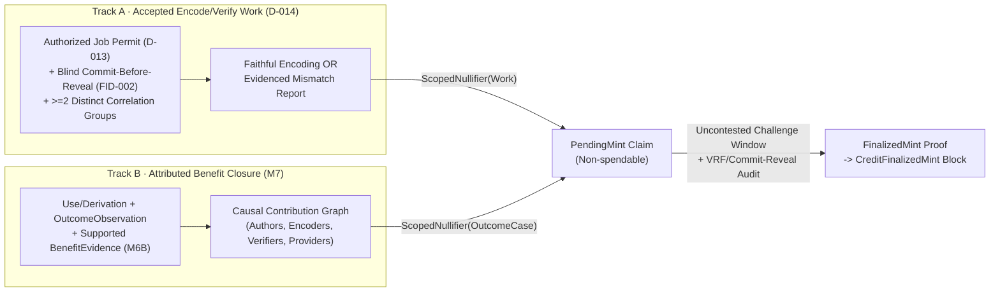

# Pillar 5 Specification — OBT Dual-Track Benefit & Accepted-Work Economy, Attribution, and Partition-Honest Settlement Profile v1

> - **Profile ID:** `P5-OBT-ECONOMY-VNEXT-001`
> - **Pillar:** `P5` (OneBrain Token — OBT Knowledge Economy)
> - **Milestone & Decisions covered:** Distributed Runtime `M7.1–M7.3`, Owner Decision `D-014` (direct issuance for accepted encode/verify work), and `P0-ADR-001`
> - **Status:** Specified (normative vNext replacement for legacy `docs/specs/obt/01..09`; runtime gate open behind `M7`)
> - **Reachability:** `spec-only (CI-checked)`
> - **Depends on:** [FIELD_OWNERSHIP_MATRIX_V1](FIELD_OWNERSHIP_MATRIX_V1.md), [NORMATIVE_VOCABULARY_V1](NORMATIVE_VOCABULARY_V1.md), [CANONICAL_PROFILE_V1](CANONICAL_PROFILE_V1.md), [LEGACY_VNEXT_PRODUCT_BOUNDARY_ADR_V1](LEGACY_VNEXT_PRODUCT_BOUNDARY_ADR_V1.md), [KNOWLEDGE_REWARD_FIREWALL_V1](KNOWLEDGE_REWARD_FIREWALL_V1.md), [P4_DISTRIBUTED_OUTCOME_BENEFIT_CONVERGENCE_PROFILE_V1](P4_DISTRIBUTED_OUTCOME_BENEFIT_CONVERGENCE_PROFILE_V1.md), [ENCODING_FIDELITY_EVIDENCE_PROFILE_V1](ENCODING_FIDELITY_EVIDENCE_PROFILE_V1.md), [ACTOR_ROOT_AUTHORITY_PROFILE_V1](ACTOR_ROOT_AUTHORITY_PROFILE_V1.md), [REVOCATION_FRESHNESS_POLICY_V1](REVOCATION_FRESHNESS_POLICY_V1.md)

## 1. Purpose and Explicit Supersession of Legacy `docs/specs/obt/01..09`

Legacy `docs/specs/obt/01_OVERVIEW.md`..`09_CONSTANTS.md` (`ku-core::obt_*`, gated behind `legacy` in `ARCH-06`) contained five foundational incompatibilities with OneBrain vNext:
1. Minting from local `QueryHit`/`Retrieval` exposure, raw KB length, passive DHT storage, and OBKG bond degree (`P0-ADR-001`, `NEG-POMV-001/002`);
2. Assuming global `active_nodes`, global `|KU_set|`, synchronized 3,600s wall-clock epoch seals, and IEEE-754 `f32`/`f64` consensus math (`FND-002`, `FND-003`);
3. Gating protocol privileges on geographic `NodeTier` (`RegionalSP..GlobalBackbone`) and punishing legitimate offline partitions via `GossipGapDetector` (`<60s` connectivity proofs);
4. Truncating principals to `u64` `NodeId`s with grindable `BLAKE3(ku_cid || epoch)` witness selection (`NEG-NET-001`, `NEG-FID-001`); and
5. Claiming 10–30s irreversible `LEVEL_SETTLED` finality with "no clawback" over asynchronous partitioned account chains where deterministic `block_hash` tiebreak retroactively orphans downstream transfers.

This specification defines the complete **vNext Pillar 5 Economic, Attribution, Firewall v2, and Partition-Honest Account-Chain Settlement Contract**, harmonizing **Milestone `M7`** (`BenefitEvidence`-driven rewards) with **Owner Decision `D-014`** (direct OBT issuance for accepted delegated encoding and blind fidelity verification work, including evidenced mismatch reports).

---

## 2. Crate Isolation, Protocol Lane (`obp/obt-ledger/1`), and Durable Firewall v2 (`M7.1`)

1. **Zero Reverse Dependency (`FW-07`, `NEG-OBT-001`):**
   - Production P5 logic **MUST** live in an isolated crate (`onebrain-obt`) consumed only through `onebrain-node`'s post-commit adapter. `ku-core`, `ku-kql`, `ku-encoder`, `onebrain-protocol` (knowledge schemas), and `ku-net` (reconciliation/discovery) **MUST NOT** depend on `onebrain-obt` or read any OBT balance, `RewardClaim`, or `AccountBlock`.
   - Network exchange uses dedicated negotiated capability `obp/obt-ledger/1` over `NET-001` authenticated QUIC sessions (retiring legacy `0xA0–0xA5`), gated behind default-off `FND-006` flags `reward_evidence_export = false` and `obt_ledger_v1 = false` with independent runtime kill switches.
2. **Durable Post-Commit Notice Outbox & Additive `RewardEvidenceNoticeV2` (`POMV-003` + `D-014`):**
   - Frozen `POMV-003` (`RewardEvidenceNotice` v1) remains unchanged. `M7.1` introduces durable Redb outbox table `vnext_reward_notice_outbox_v2` storing `RewardEvidenceNoticeV2`:
     - `BenefitClosureNotice { benefit_event_cid: EventCid, outcome_case_id: [u8; 32], evidence_frontier_root: [u8; 32], policy_cid: ObjectCid }` (`M7` Track B);
     - `AcceptedWorkNotice { work_record_cid: ObjectCid, attestation_event_cid: EventCid, work_kind: AcceptedWorkKind::{DelegatedEncode, BlindFidelityVerify}, evidence_frontier_root: [u8; 32], policy_cid: ObjectCid }` (`D-014` Track A — amending `FID-001/002/003` no-export clauses solely via this one-way post-commit notice without adding token fields to `FID` objects!).
   - **Shadow Mode (`M7.1` Gate):** Under `obt_mode = ShadowEvaluate`, the P5 worker drains notices and computes deterministic `RewardClaimCandidate` records with **strictly zero** `AccountBlock` or balance mutations; full queue backpressure or consumer corruption drops/quarantines notices only, never failing knowledge commits.

---

## 3. Canonical Atomic Unit, Fixed-Point Math, and `ActorId` Account Custody

1. **Single Canonical Unit & Zero Floating-Point Consensus Math:**
   - All OBT quantities **MUST** be represented as unsigned 128-bit integer atomic units `u128` (`1 OBT = 1_000_000_000 micro_nano_obt = 10^9 base_quanta`, resolving the legacy `1 OBT` vs `milliOBT` contradiction).
   - Every budget, share, cap, decay, and fee calculation **MUST** use checked integer / rational arithmetic (`u128` with basis points `10_000 bps = 100%` and floor division; deterministic `remainder` stays unminted, never rounded up). `f32` and `f64` are **PROHIBITED** in all `P5` schemas and validators (`FND-003`).
2. **`ActorId` Account Ownership & Key Rotation (`IDN-002`, `ACTOR_ROOT_AUTHORITY_PROFILE_V1`):**
   - Each ledger account is keyed by 32-byte `ActorId` (never `u64` `NodeId`). Blocks are signed by a `FeedEventSigner` (`FeedId`) proven `AUTHORIZED_RELATIVE` for `EFFECT_OBT_LEDGER_SIGN` under that `ActorId`'s key-state frontier and `REV-001` **`R4`** freshness (`60s` terrestrial live-in-transcript confirmation), enabling safe device-key rotation without losing account continuity.
3. **Geography & Identity Neutrality (`Baseline §1.5`, `§3.4`, `§3.8`):**
   - `RewardPolicyV1` **MUST NOT** accept geographic region, IP prefix, `NodeTier`, fiat exchange rate, local wage index, or beneficiary identity rank as inputs. Identical proof closures under the same `RewardPolicyV1` `ObjectCid` **MUST** yield the exact same `u128` reward on Earth, in orbit, or on Mars.

---

## 4. Dual-Track Issuance Model: Harmonizing `D-014` (Track A) and `M7` (Track B)

### 4.1 Track A — Direct Issuance for Accepted Encode & Blind Verify Work (`D-014`)

Per Owner Decision `D-014`, accepted cognitive encoding and independent fidelity verification earn direct protocol issuance without waiting for a downstream `BenefitEvidence` event, subject to five strict anti-gaming invariants:

1. **Eligible Work Proof Closure (`WorkRewardClaimV1`):**
   - Must reference: (a) a requester-authorized `DelegatedWorkJob` (`D-013` / `P6`) with valid `SourceAccessPermit` (preventing self-generated spam floods of synthetic text); (b) a blind commit-before-reveal `EncodingAttempt` + `EncodingFidelityAttestation` portfolio (`FID-001/002`); and (c) $\ge 2$ evidenced-distinct `CorrelationEvidence` verifier groups (`P4` §5).
2. **Evidenced-Mismatch Symmetry (`D-014` Anti-Rubber-Stamping Invariant):**
   - A verifier's `EncodingFidelityAttestation` is **equally reward-eligible** whether it proves source-faithful alignment **or** proves a concrete, span-grounded semantic mismatch (`HardMismatchEvidence` verified deterministically against `SourceArtifact` quotes/units/negation). Rewarding agreement-only is **PROHIBITED** (`DECISIONS.md` `D-014`).
3. **Complexity-Bounded Fixed-Point Formula (Rejecting Legacy Raw-KB Formula):**
   - Work reward is computed from canonical structural work units (`verified_statement_count` capped at `32`, `resolved_constraint_count` capped at `64`, and `WorkClass` weight in `RewardPolicyV1`), **never** from raw UTF-8 byte length (which incentivizes verbose padding).
   - Per-principal and per-correlation-group epoch issuance caps prevent Sybil farming even under colluding requester-worker pairs.
4. **Work `ScopedNullifier`:**
   - `Nullifier_Work = BLAKE3("onebrain:vnext:obt-work-nullifier:1\0" || source_artifact_cid || compiler_profile_cid || role_slot || worker_actor_id || reward_policy_cid)` guarantees at most one payout per eligible worker slot per `(source_artifact_cid, profile)`.

### 4.2 Track B — Benefit-Attributed Issuance (`M7`)

1. **Eligible Benefit Proof Closure (`BenefitRewardClaimV1`):**
   - Requires a `SupportedUncontested` `BenefitClosureView` (`P4` §4) with continuous `task_context_commitment` across `Use`/`Derivation` → `OutcomeObservation` → `BenefitEvidence` and multi-group corroboration satisfying `RewardPolicyV1` (self-reported / unwitnessed closures are `0` or capped to a policy micro-ceiling).
2. **Deterministic Integer `BenefitBudget` & Conservation of Attribution:**
   $$\text{BenefitBudget} = \left\lfloor \frac{B_{\text{base}}(\text{outcome\_class}) \times G_{\text{norm}} \times F_{\text{evidence}} \times F_{\text{causal}} \times F_{\text{corr}}}{10\_000^4} \right\rfloor$$
   where each factor $\in [0, 20\_000]$ bps is an exact integer lookup defined in `RewardPolicyV1`.
   - `AttributionGraph` distributes shares $s_k \in \mathbb{N}$ (in bps) across causal contributors (KU/Assembly/Mapping authors along `DerivationEvidence` DAG with integer hop-attenuation, Track A encoders/verifiers via residualroyalty share, and verified `ProviderLease` delivery servers) such that:
     $$\sum_{k} s_k \le 10\_000\text{ bps}, \quad \sum_{k} \left\lfloor \frac{\text{BenefitBudget} \times s_k}{10\_000} \right\rfloor \le \text{BenefitBudget}$$
3. **Benefit `ScopedNullifier` (Enabling Late/Retroactive Real-World Impact):**
   - `Nullifier_Benefit = BLAKE3("onebrain:vnext:obt-benefit-nullifier:1\0" || outcome_case_id || task_context_commitment || reward_policy_cid)`.
   - Prevents replay or claim-splitting of the same `OutcomeCaseId` across partitions, while allowing the **same KU** to earn legitimate new `BenefitBudget`s whenever distinct real-world `OutcomeCaseId`s emerge years later.

---

## 5. Pre-Finality Challenge Window & Partition-Honest Account-Chain Settlement (`M7.2–M7.3`)

### 5.1 `PendingMint → ChallengeWindow → Audit → FinalizedMint`

1. Approved `WorkRewardClaimV1` and `BenefitRewardClaimV1` records first create a **non-spendable, non-transferable** `PendingMintRecord` (`kind` in `onebrain-obt`).
2. **Non-Grindable Auditor Selection:** Challenge-window auditors are selected via commit-reveal epoch entropy / VRF over active `EvaluatorPermit` feeds (`onebrain:vnext:obt-audit-vrf:1\0`), **never** via `BLAKE3(ku_cid || epoch)`.
3. If an authorized opposing `OutcomeObservation` (`Harmful`), `EquivocationWarrant`, or `InvalidWorkProof` arrives before the frontier challenge window closes, `PendingMintRecord` transitions to `VoidedOrFrozen` (zero clawback of already-spent tokens needed because `PendingMint` could not be spent!). Only upon uncontested window completion + required audit co-signatures does it emit `FinalizedMintCertificate`.

### 5.2 Account-Chain Blocks & Explicit CAP-Honest Settlement States

Each `ActorId` chain consists of canonical CBOR `AccountBlockV1` records (`OpenAccount | CreditFinalizedMint | SendTransfer | ReceiveTransfer | CancelExpiredSend`) with monotonic `seq: u64`, `prev_block_cid: Option<AccountBlockCid>`, exact `balance_after: u128`, `nullifier: Option<[u8; 32]>`, and `R4` `FeedId` signature.

To resolve the legacy partition-finality fallacy (`FND-002` `final` rule & `Baseline §47.3`):

| Settlement State | Exact Protocol Meaning | Spendability & UI Presentation |
|---|---|---|
| `PROVISIONAL_PARTITION_LOCAL` | Valid signature, sequence, balance, and nullifier relative to the local node's observed frontier, **without** a closed quorum checkpoint certificate. | Usable only as **explicitly provisional** credit if recipient opts in; UI **MUST** display `[Provisional — unquorumed partition state, subject to double-spend fork risk]`. |
| `FINAL_IN_DOMAIN(domain_id, checkpoint_proof)` | Covered by a signed threshold `SettlementDomainCheckpoint` (`>= 2f + 1` weight in named `SettlementDomainManifest` `domain_id`) proving unique sequence `(ActorId, seq)` and global `ScopedNullifier` non-collision within `domain_id`. | Irreversible within `domain_id` (`FND-002` compliant closed proof domain); eligible for settled balance display once `M7.3` gate passes. |
| `FROZEN_EQUIVOCATED(warrant_cid)` | Two distinct valid signatures exist for the same `(ActorId, seq)` (`AccountEquivocationWarrant`). | Both conflicting branches and unfinalized downstream `ReceiveTransfer` blocks citing the conflicting `SendTransfer` freeze deterministically; already `FINAL_IN_DOMAIN` blocks remain untouched (an actor cannot equivocate an already checkpoint-finalized `seq` inside `domain_id`). |

### 5.3 Reachability-Honest Offline Safety (Zero Penalty for Offline Islands)

- Being offline, on a submarine, or on Mars **MUST NEVER** trigger slashing, `Jail`, or trust decay (retiring `GossipGapDetector` and `<60s ConnectivityProof`). Disconnected islands accumulate `PendingMintRecord`s and `PROVISIONAL_PARTITION_LOCAL` blocks locally and complete `SettlementDomainCheckpoint` finality upon reunion.
- Economic rate limits and `AccountEquivocationWarrant` penalties apply **exclusively** to `P5` `RewardClaim` and `AccountBlock` admission — **never** to `P1` KU creation, `P3` KQL queries, `P8` storage, or `P2` OBP sync (`NEG-OBT-001`).
- Until all `M7` exit gates and external economic/security audits pass, all product surfaces (`P10`) **MUST** keep `economic_status = "simulated_non_economic"` (`P0-ADR-001`).
