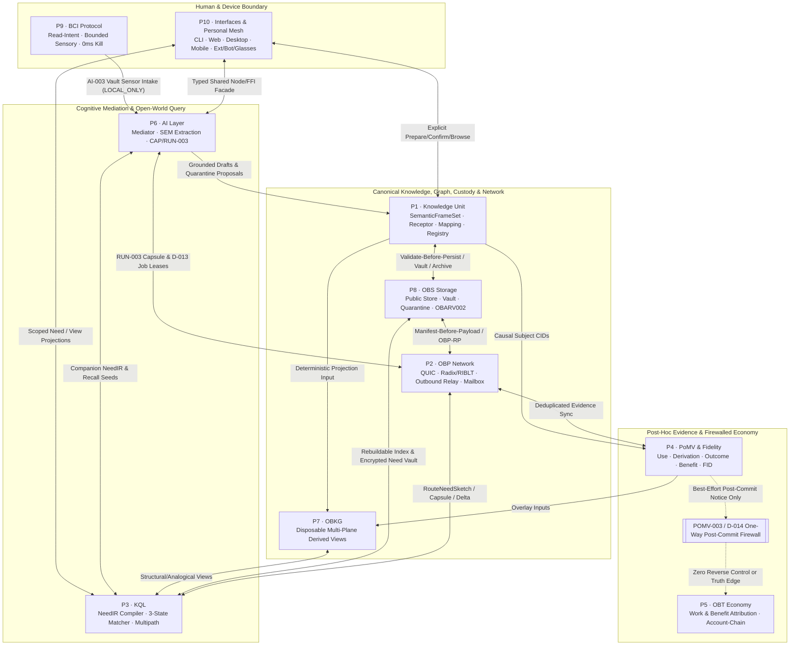
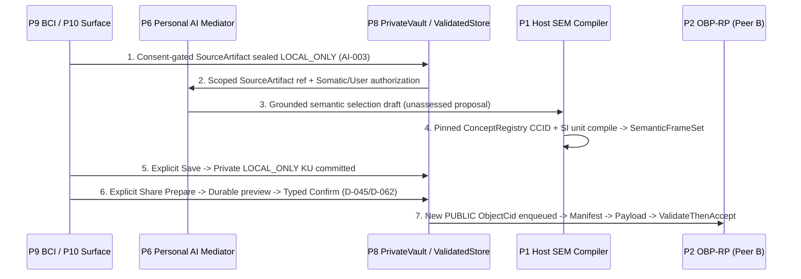

# OneBrain vNext — Ten-Pillar Architecture and Cross-Pillar Interaction Matrix v1

> - **Profile ID:** `ARCH-10P-001`
> - **Status:** Specified (normative cross-pillar architecture & interaction contract)
> - **Reachability:** `spec-only (CI-checked)`
> - **Machine contract:** [`ten-pillar-architecture-v1.json`](../../../src/test-vectors/vnext/ten-pillar-architecture-v1.json)
> - **Normative authorities:** [Research Baseline v7.1](../../research/ONEBRAIN_RESEARCH_BASELINE_V7_1.md) (`§1`, `§18`, `§46.3`, `§47`, `§56.1`), [Field Ownership Matrix v1](FIELD_OWNERSHIP_MATRIX_V1.md) (`FND-001`), [Normative Vocabulary v1](NORMATIVE_VOCABULARY_V1.md) (`FND-002`), [Legacy/vNext Product Boundary ADR v1](LEGACY_VNEXT_PRODUCT_BOUNDARY_ADR_V1.md) (`P0-ADR-001`), [Owner Decisions](../../handoffs/2026-09-ku-obp-productization/DECISIONS.md) (`D-001..D-075`)

## 1. Purpose and Architectural Thesis

OneBrain is organized into ten orthogonal pillars (`P1`–`P10`). Earlier legacy documents described each pillar in isolation or allowed implicit coupling (such as network transport granting authorship, query exposure minting tokens, or graph heuristics mutating canonical knowledge).

This specification establishes the **complete, closed cross-pillar interaction contract** across all ten pillars. Every cross-pillar edge in OneBrain **MUST** obey three structural laws:

1. **Disjoint Domain Ownership (`FND-001`):** Semantic meaning (`P1`), transport/reachability (`P2`), query/discovery (`P3`), exercise/outcome evidence (`P4`), post-commit economic settlement (`P5`), cognitive mediation (`P6`), derived graph topology (`P7`), durable custody (`P8`), somatic/neural I/O (`P9`), and client projection (`P10`) own disjoint fields and identities.
2. **Directed Acyclic Authority & CID Precedence:** Upper semantic layers never embed lower operational, derived, availability, or economic CIDs. No reverse authority edge returns from `P5` (OBT), `P7` (OBKG), `P2` (relays/seeds), or `P6` (unverified model scores) into canonical knowledge validity or eligibility.
3. **Partition Confluence Split (`Baseline §47.3`):** Pillars `P1`–`P4` and `P6`–`P10` operate over an asynchronous, partition-autonomous convergent union (`ValidatedUnion`: commutative, associative, idempotent) requiring zero global clocks or quorums; non-I-confluent balance settlement in `P5` runs on an isolated post-commit lane that **MUST NOT** block or alter any knowledge-plane operation.

---

## 2. Canonical Ten-Pillar Inventory & Normative Spec Closure

Every pillar `P1`–`P10` now has complete normative vNext specification coverage:

| Pillar | Primary Role | FND-001 Ownership Domains | Core Foundation Contracts | Gap-Closing Pillar Specification |
|---|---|---|---|---|
| **P1 · Knowledge Unit (KU)** | Immutable semantic frames, Receptors, Affordances, Assemblies, Mappings, Concept Registry | `SEMANTIC_IDENTITY`, `PROVENANCE_EVIDENCE` | [IDENTITY_OBJECT_PROFILE_V1](IDENTITY_OBJECT_PROFILE_V1.md), [SEMANTIC_PRIMITIVES_V1](SEMANTIC_PRIMITIVES_V1.md), [RECEPTOR_PROFILE_V1](RECEPTOR_PROFILE_V1.md), [KNOWLEDGE_AFFORDANCE_PROFILE_V1](KNOWLEDGE_AFFORDANCE_PROFILE_V1.md), [ASSEMBLY_MANIFEST_PROFILE_V1](ASSEMBLY_MANIFEST_PROFILE_V1.md), [MAPPING_PROFILE_V1](MAPPING_PROFILE_V1.md), [KU_PRODUCT_WORKFLOW_PROFILE_V1](KU_PRODUCT_WORKFLOW_PROFILE_V1.md), [CONCEPT_REGISTRY_OPERATIONS_PROFILE_V1](CONCEPT_REGISTRY_OPERATIONS_PROFILE_V1.md) | [P1_CONCEPT_LIFECYCLE_AND_REGISTRY_DISTRIBUTION_PROFILE_V1](P1_CONCEPT_LIFECYCLE_AND_REGISTRY_DISTRIBUTION_PROFILE_V1.md) |
| **P2 · OneBrain Protocol (OBP)** | Authenticated sessions, 5-lane radix inventory, OBP-RP reconciliation, outbound relays, provider leases | `AVAILABILITY`, `RUNTIME_CONTROL` (transport) | [AUTHENTICATED_SESSION_PROFILE_V1](AUTHENTICATED_SESSION_PROFILE_V1.md), [HYBRID_INVENTORY_FOREST_PROFILE_V1](HYBRID_INVENTORY_FOREST_PROFILE_V1.md), [OBP_RECONCILIATION_PROTOCOL_PROFILE_V1](OBP_RECONCILIATION_PROTOCOL_PROFILE_V1.md), [OUTBOUND_FIRST_REACHABILITY_PROFILE_V1](OUTBOUND_FIRST_REACHABILITY_PROFILE_V1.md), [PROVIDER_LEASE_RETIRE_PROFILE_V1](PROVIDER_LEASE_RETIRE_PROFILE_V1.md) | [P2_FAST_RECONCILIATION_MAILBOX_AND_BLOB_TRANSPORT_PROFILE_V1](P2_FAST_RECONCILIATION_MAILBOX_AND_BLOB_TRANSPORT_PROFILE_V1.md) |
| **P3 · Knowledge Query Language (KQL)** | Local semantic index, deterministic `NeedIR` compilation, 3-state matching, private multipath discovery | `LOCAL_PRIVATE_STATE`, `RUNTIME_CONTROL`, `DERIVED_VIEW` | [KQL_QUERY_BOUNDARY_PROFILE_V1](KQL_QUERY_BOUNDARY_PROFILE_V1.md), [KQL_SEMANTIC_INDEX_PROFILE_V1](KQL_SEMANTIC_INDEX_PROFILE_V1.md), [KQL_EXACT_TYPED_MATCHER_PROFILE_V1](KQL_EXACT_TYPED_MATCHER_PROFILE_V1.md), [STANDING_NEED_MINIMAL_VIEW_PROFILE_V1](STANDING_NEED_MINIMAL_VIEW_PROFILE_V1.md), [KQL_PRIVATE_MULTIPATH_PROFILE_V1](KQL_PRIVATE_MULTIPATH_PROFILE_V1.md), [DISCLOSURE_POLICY_SANITIZER_V1](DISCLOSURE_POLICY_SANITIZER_V1.md) | [P3_KQL_NEED_COMPILER_AND_ACTIVE_DISCOVERY_PROFILE_V1](P3_KQL_NEED_COMPILER_AND_ACTIVE_DISCOVERY_PROFILE_V1.md) |
| **P4 · Proof of Metabolic Value (PoMV)** | Signed Use/Derivation/Outcome/Benefit evidence, blind encoding fidelity, one-way reward firewall | `PROVENANCE_EVIDENCE`, `DERIVED_VIEW` | [USE_DERIVATION_EVIDENCE_PROFILE_V1](USE_DERIVATION_EVIDENCE_PROFILE_V1.md), [METABOLIC_EVIDENCE_VIEW_V1](METABOLIC_EVIDENCE_VIEW_V1.md), [OUTCOME_BENEFIT_EVIDENCE_PROFILE_V1](OUTCOME_BENEFIT_EVIDENCE_PROFILE_V1.md), [ENCODING_FIDELITY_EVIDENCE_PROFILE_V1](ENCODING_FIDELITY_EVIDENCE_PROFILE_V1.md), [FIDELITY_ASSESSMENT_REDUCER_V1](FIDELITY_ASSESSMENT_REDUCER_V1.md), [KNOWLEDGE_REWARD_FIREWALL_V1](KNOWLEDGE_REWARD_FIREWALL_V1.md) | [P4_DISTRIBUTED_OUTCOME_BENEFIT_CONVERGENCE_PROFILE_V1](P4_DISTRIBUTED_OUTCOME_BENEFIT_CONVERGENCE_PROFILE_V1.md) |
| **P5 · OneBrain Token (OBT)** | Post-commit attribution, `D-014` accepted-work & `M7` benefit issuance, partition-honest account-chain settlement | Outside knowledge-plane (`ECONOMIC_CONSUMER`) | [LEGACY_VNEXT_PRODUCT_BOUNDARY_ADR_V1](LEGACY_VNEXT_PRODUCT_BOUNDARY_ADR_V1.md), [KNOWLEDGE_REWARD_FIREWALL_V1](KNOWLEDGE_REWARD_FIREWALL_V1.md) | [P5_OBT_BENEFIT_AND_WORK_ECONOMY_PROFILE_V1](P5_OBT_BENEFIT_AND_WORK_ECONOMY_PROFILE_V1.md) |
| **P6 · AI Layer** | Sovereign Personal AI Mediator, grounded semantic extraction, capability permits, `RUN-003` remote cognition | `RUNTIME_CONTROL`, `PROVENANCE_EVIDENCE`, `AUTHORITY` (permits) | [CAPABILITY_LAYER_PROFILE_V1](CAPABILITY_LAYER_PROFILE_V1.md), [DELEGATION_PERMIT_VALIDATION_PROFILE_V1](DELEGATION_PERMIT_VALIDATION_PROFILE_V1.md), [TYPED_COGNITIVE_EXECUTOR_PROFILE_V1](TYPED_COGNITIVE_EXECUTOR_PROFILE_V1.md), [AI_LOCAL_OBSERVATION_INTAKE_V1](AI_LOCAL_OBSERVATION_INTAKE_V1.md), [AI_MODEL_RECALL_FIREWALL_V1](AI_MODEL_RECALL_FIREWALL_V1.md), [AI_LOCAL_KNOWLEDGE_COMPANION_V1](AI_LOCAL_KNOWLEDGE_COMPANION_V1.md), [KU_EXTRACTION_FRAMEWORK_PROFILE_V1](KU_EXTRACTION_FRAMEWORK_PROFILE_V1.md), [KU_SEMANTIC_SELECTION_PROFILE_V2](KU_SEMANTIC_SELECTION_PROFILE_V2.md) | [P6_REMOTE_COGNITION_AND_PERSONAL_MEDIATOR_PROFILE_V1](P6_REMOTE_COGNITION_AND_PERSONAL_MEDIATOR_PROFILE_V1.md) |
| **P7 · Knowledge Graph (OBKG)** | Disposable multi-plane Receptor/Affordance/Assembly/Mapping projections & firewalled discovery heuristics | `DERIVED_VIEW` (zero independent source-of-record) | [OBKG_DERIVED_PROJECTION_PROFILE_V1](OBKG_DERIVED_PROJECTION_PROFILE_V1.md), [RECEPTOR_RESOLUTION_PROFILE_V1](RECEPTOR_RESOLUTION_PROFILE_V1.md), [MAPPING_MATERIALIZATION_PROFILE_V1](MAPPING_MATERIALIZATION_PROFILE_V1.md) | [P7_UNIFIED_OBKG_AND_CROSS_DOMAIN_DISCOVERY_PROFILE_V1](P7_UNIFIED_OBKG_AND_CROSS_DOMAIN_DISCOVERY_PROFILE_V1.md) |
| **P8 · OneBrain Storage (OBS)** | Validated Public Store, encrypted Private Vault, Quarantine, `OBARV002` archives, blobs, checkpoints/GC | Custody & transaction boundaries for all classes | [VALIDATED_STORAGE_PROFILE_V1](VALIDATED_STORAGE_PROFILE_V1.md), [BASE_V1_AUTHORITY_AND_RECOVERY_PROFILE](BASE_V1_AUTHORITY_AND_RECOVERY_PROFILE.md), [BASE_V1_STORAGE_INTEGRITY_PROFILE](BASE_V1_STORAGE_INTEGRITY_PROFILE.md), [OPERATIONAL_COMPACTION_PROFILE_V1](OPERATIONAL_COMPACTION_PROFILE_V1.md), [CHECKPOINT_COMPACTION_AND_LOCAL_GC_PROFILE_V1](CHECKPOINT_COMPACTION_AND_LOCAL_GC_PROFILE_V1.md) | [P8_GENERATION_ARCHIVE_AND_CROSS_STORE_RECOVERY_PROFILE_V1](P8_GENERATION_ARCHIVE_AND_CROSS_STORE_RECOVERY_PROFILE_V1.md) |
| **P9 · BCI Protocol** | Somatic/neural read-intent intake, hardware-bounded sensory feedback, `0-ms` revocation, raw-signal Vault lock | `LOCAL_PRIVATE_STATE`, `AUTHORITY` (`SomaticImmediate/1`) | [AI_LOCAL_OBSERVATION_INTAKE_V1](AI_LOCAL_OBSERVATION_INTAKE_V1.md), [REVOCATION_FRESHNESS_POLICY_V1](REVOCATION_FRESHNESS_POLICY_V1.md), [DISCLOSURE_POLICY_SANITIZER_V1](DISCLOSURE_POLICY_SANITIZER_V1.md), [THREAT_MODEL_V1](THREAT_MODEL_V1.md) | [P9_BCI_NEURAL_INTENT_AND_SAFETY_PROFILE_V1](P9_BCI_NEURAL_INTENT_AND_SAFETY_PROFILE_V1.md) |
| **P10 · User Interfaces & Surfaces** | CLI, REST/WS, Web, Desktop, Mobile, Personal Mesh sync, & scoped Extension/Bot/Glasses adapters | Client projection over shared node/mobile runtime | [VNEXT_PRODUCT_INTEGRATION_PROFILE_V1](VNEXT_PRODUCT_INTEGRATION_PROFILE_V1.md), [VNEXT_REST_API_PROFILE_V1](VNEXT_REST_API_PROFILE_V1.md), [VNEXT_PRIVATE_WEBSOCKET_PROFILE_V1](VNEXT_PRIVATE_WEBSOCKET_PROFILE_V1.md), [VNEXT_CLI_PROFILE_V1](VNEXT_CLI_PROFILE_V1.md), [VNEXT_DESKTOP_WEB_UX_PROFILE_V1](VNEXT_DESKTOP_WEB_UX_PROFILE_V1.md), [ACTOR_ROOT_AUTHORITY_PROFILE_V1](ACTOR_ROOT_AUTHORITY_PROFILE_V1.md) | [P10_MULTI_SURFACE_SYNC_AND_CLIENT_ADAPTER_PROFILE_V1](P10_MULTI_SURFACE_SYNC_AND_CLIENT_ADAPTER_PROFILE_V1.md) |

---

## 3. System-Wide Interaction Topology

### 3.1 Acyclic Layer Ordering

Every canonical CID reference and synchronous transaction dependency **MUST** respect the strict partial order:

$$\text{P1 (Semantic Kernel)} \prec \text{P1/P4/P6 (Provenance Envelopes \& Signed Events)} \prec \text{P8 (Validated Custody)} \prec \text{P3/P7/P4 (Derived Views)} \prec \text{P10 (UI Projections)}$$

and across runtime execution planes:

$$\text{Knowledge Commit (\{P1, P2, P3, P4, P6, P7, P8\})} \prec \text{Post-Commit Firewall Notice} \prec \text{P5 Economic Evaluation}$$

A lower or downstream plane **MUST NOT** inject fields, scores, balances, route counts, or statuses back into an upstream canonical byte representation.

---

## 4. Complete Cross-Pillar Interaction Contract Table

Every permitted cross-pillar interaction uses explicit typed contracts, domain-separated BLAKE3 digests, and fail-closed guards:

| Directed Seam | Canonical Artifacts / Messages Crossing Seam | Required Authority & Freshness | Disclosure Ceiling & Invariant |
|---|---|---|---|
| **P9 → P6 / P8** | `SourceArtifact(Sensor/NeuralWindow)` (`kind=22`), `ObservationEvent` (`evt=7`, `kind=23`), `ObservationEncodingProposal` | Root `ActorId` + `SomaticImmediate/1` (`R4`, `onward_delegation=false`) | Permanently `LOCAL_ONLY` in `PrivateVault`; non-sanitizable taint forbids `ROUTE_MINIMAL` and `NEGOTIATED_ENCRYPTED`. |
| **P6 → P9** | `SensoryFeedbackFrame` over HAL gateware safety envelope | `SignedDelegationPermit(EFFECT_SENSORY_FEEDBACK)` + live `SomaticImmediate/1` token | Hardware-enforced charge/amplitude/duty ceiling; `0-ms` cut-off on wear loss or `ErrP`; `EFFECT_ARBITRARY_NEURAL_WRITE` fails closed. |
| **P10 ↔ P6** | Mediator intake/response DTOs, `SourceArtifact` refs, non-executing `Recommendation` cards (`RecommendationGuard`) | Scoped surface capability (`obc_surface1`) or in-process host handle | AI responses and recommendations perform zero durable/network side effects without separate user confirmation (`AI-004`). |
| **P6 → P1** | `ku-semantic-selection/1.0..2.0` private drafts, `ResolvedSemanticDraft`, `ReceptorEncodingDraft`, `KnowledgeAffordance` draft | `ObservationGovernance` source consent + pinned signed `ConceptRegistry` | Models return grounded proposals only; host compiler owns CCID lookup, SI unit algebra, and `SemanticFrameSet` compilation (`D-017`). |
| **P6 ↔ P3** | `CompanionContext` → `KnowledgeNeedIr`, `RecallCandidateSeed` → `ModelRecallFirewall` (`AI-002`) | `R1` local reasoning; `R3` if triggering `SEC-003` capsule | Model/embedding scores rank candidate recall only and **MUST NOT** enter `ExactTypedMatcher` or `SymbolicMappingValidator` (`ADR-KU-046-05`). |
| **P6 ↔ P2** | `RUN-003` `CognitiveTask` inside `DisclosureCapsuleV1` (`obp/cognition/1`); `D-013` delegated encode/verify leases | `SignedDelegationPermit` (`CAP-004`, `R3`, `DeleteAfterTask`) + `NET-001` session | Remote output enters `OBS-002` `QuarantineRecord` (`is_executable=false`); verification pass **MUST NOT** auto-materialize or adopt (`NEG-CAP-002`). |
| **P1 ↔ P8** | `KnowledgeObjectEnvelope` (`kinds 1..23`), `KnowledgeEventEnvelope` (`evt 1..7`), `OwnedBlobReferenceV1` (`BlobCid` 34B) | `FeedEventSigner` (`DR-P1.2`) + `ValidatedStore` / `PrivateVault` class match | `Public`/`RouteMinimal` → `ValidatedStore`; `LocalOnly`/`NegotiatedEncrypted` → XChaCha20-Poly1305 `PrivateVault`; mismatches reject (`STORE_CLASS_MISMATCH`). |
| **P1 ↔ P2** | `VNextMessage` (`PROTO-001`), `ConceptCcid` (16B), 32B CIDs, `obp/registry-chunks/1` (`D-012`), `obp/blob-chunks/1` | `SessionIdentitySigner` (`NodeId`) for transport; `AuthorityEvent` frontier for content | Transport peer gains zero author/content/Registry authority (`NEG-NET-002`); local `u64` `ConceptId` and `.obr` gossip are forbidden on wire. |
| **P1 ↔ P3** | `SemanticFrameSet`, `ReceptorDefinition`, `KnowledgeAffordance` → `BindingProposal` (`ProposalQuarantine`) → `MaterializeMappingCommand` → `ADOPT_BINDING` | Separate explicit authority at `Materialize` (`KU-006`) and placement-scoped `ADOPT_BINDING` (`KU-007`) | Strict 3-stage boundary: retrieval/matching creates quarantined `BindingProposal` only (`NEG-MAP-001..004`). |
| **P1 → P7** | Immutable P1 objects + `ReceptorResolutionEvent`s → `ObkgProjectionSnapshot` (`OBKG-001/002`) | Deterministic local projection (`R0`) | `P7` is 100% disposable/rebuildable; `is_active_edge()` holds **iff** Mapping is both materialized and adopted at the named frontier. |
| **P3 ↔ P7** | `StructuralSignature` (`KQL-007`), `TypedRelationalAlignment` (`KQL-008`), `AssemblySearch` (`KQL-009`), `ExplorationPolicyV1` (`KQL-010`) | Local deterministic/bounded run (`QueryRun` budgets) | Enforces 10/20/30/40 exploration floor & starvation debt; Dream/KGE heuristics emit quarantined `BindingProposal`s only. |
| **P3 ↔ P8** | `RedbPrivateNeedVault` (`PrivateNeedBundle` + cancel/retire tombstones under `LocalNeedVaultKey`), `DurableMatchIndex` | Caller-owned `LocalNeedVaultKey` + `0x000B` archive key-wrapping | Tombstones persist across compaction and `OBARV002` restore so retired/canceled private Needs never resurrect (`DR-P1.4`). |
| **P3 ↔ P2** | M3 `KnowledgeAffordance` reconciliation delta; M6A `RouteNeedSketchV1` (≤3 packets, support ≥64) & `DisclosureCapsuleV1`; `DHT-001/002` `LeaseCid` | `SEC-001` disclosure policy + `CAP-004` bilateral permit for capsules (`R2`/`R3`) | Full `KnowledgeNeedIr`, `StandingNeedId`, and raw KQL have zero wire encoding (`NEG-KQL-001/005`); zero results never claim global absence (`NEG-KQL-002`). |
| **P2 ↔ P8** | `OBP-RP/1` (`RadixForest256V1` + optional `RIBLT-1`), `RedbReconciliationJournalBackend`, `OutboundOutbox`, `obp/mailbox/1` | Authenticated transcript binding + `Selector` storage-class check (`INV-001`) | Manifest-before-payload & validate-then-accept; `RIBLT-1` requires exact Merkle root verification or fallback (`NEG-NET-004`). |
| **P1/P3/P6 → P4** | `UseEvidencePayload` (`kind=13`), `DerivationEvidencePayload` (`kind=14`), `OutcomeObservationPayload` (`kind=19`), `BenefitEvidencePayload` (`kind=20`), `EncodingFidelityAttestation` | `FeedEventSigner` + two-step `PublicUseConsent` (`DR-P1.3`) for public disclosure | `QueryHit`/retrieval/chat display is `ExposureTelemetry` only, **never** `UseEvidence` (`NEG-POMV-001`); `Use` alone is **never** `Benefit` (`NEG-POMV-002`). |
| **P2 ↔ P4** | Cross-peer OBP-RP sync of signed `Use`/`Derivation`/`Outcome`/`Benefit`/`Fidelity` records (`M4` + `M6B`) | Independent per-author `FeedAuthorityDecision` at local validated frontier (`DR-P1.5`) | Out-of-order refs enter non-terminal `DeferredMissingDependency`; multi-bridge replay deduplicates by `EventCid`; `OutcomeCaseId` preserves conflicts. |
| **P4 → P7** | `MetabolicEvidenceView`, `OutcomeBranchView`, `FidelityAssessment` overlays onto `ObkgProjectionSnapshot` | Frontier/policy-qualified reducer (`R0`) | Overlays annotate edges/nodes with provenance and conflicts without deleting low-use or refuted branches (`NEG-KU-002/004`, `NEG-POMV-003`). |
| **P4/P6 → P5** | Post-commit `RewardEvidenceNoticeV2` (`BenefitClosure` for `M7` + `AcceptedEncodeVerifyWork` for `D-014`) across durable notice outbox | Independent default-off flags (`reward_evidence_export`, `obt_ledger_v1`) | One-way post-commit notice only; consumer unavailable/full/corrupt drops or quarantines notices only with **zero** knowledge-plane error (`NEG-OBT-001`). |
| **P10 ↔ P1/P2/P3/P4/P8** | Shared `onebrain-node` / `onebrain-mobile-core` service operations, Personal Mesh `NEGOTIATED_ENCRYPTED` sync (`ActorDelegation/1` / `ActorRevocation/1`) | Per-surface `obc_surface1` capability + `R3`/`R4` typed confirmation receipts | Offline mode remains fully usable (`USABLE_OFFLINE`); Extension/Bot/Glasses cannot invoke `obm1` management or unilateral `PUBLIC` confirmation. |

---

## 5. The Ten Normative Cross-Pillar Firewalls (`FW-01`..`FW-10`)

1. **`FW-01` (Encode ≠ Publish Firewall):** Local manual authoring, AI extraction (`P6`), and remote/delegated encoding (`D-013`) **MUST** produce `LOCAL_ONLY` or `NEGOTIATED_ENCRYPTED` artifacts by default. Creating a `PUBLIC` object requires a separate two-step prepare/confirm gesture producing a distinct `ObjectCid`.
2. **`FW-02` (Proposal ≠ Materialize ≠ Adopt Firewall):** Discovery (`P3`), model recall (`P6`), and offline consolidation (`P7` Dream) **MUST** output non-executable `BindingProposal`s in `ProposalQuarantine`. Durable `MappingKernel + MappingEnvelope` storage requires an authorized `MaterializeMappingCommand`, and Assembly satisfaction requires a separate placement-scoped `ReceptorResolutionEvent`.
3. **`FW-03` (Symbolic Validity / Model Recall Firewall):** Embedding similarity, KGE scores, and LLM confidences (`P6`/`P7`) **MUST NOT** be inputs to `ExactTypedMatcher`, `SymbolicMappingValidator`, or `SEM` unit/dimension validity.
4. **`FW-04` (Private Cognitive Intent & Taint Firewall):** Full `KnowledgeNeedIr`, `StandingNeed`, `ReceptorClaimEnvelope` plaintext, `LocalNeedVaultKey`, and raw `P9` neural/biometric telemetry **MUST NOT** be serialized onto public OBP-RP lanes, relays, or DHT records.
5. **`FW-05` (Transport & Availability ≠ Authority Firewall):** Seeds, relays, mailboxes, mirrors, DHT nodes, and transport `NodeId` peers (`P2`) **MUST NOT** acquire authorship, Registry signing, fidelity independence, or resolution authority over payloads they carry or cache.
6. **`FW-06` (Exposure ≠ Use ≠ Benefit ≠ Truth Firewall):** Search hits, UI views, and chat RAG (`P3`/`P6`/`P10`) **MUST** record at most local `ExposureTelemetry`; signed `UseEvidence` **MUST NOT** imply `BenefitEvidence`; neither PoMV nor fidelity attestations (`P4`) may vote a proposition true or false.
7. **`FW-07` (One-Way Knowledge → Economy Firewall):** All `P1`/`P2`/`P3`/`P4`/`P6`/`P7`/`P8` transactions **MUST** commit before enqueueing any `RewardEvidenceNotice` to `P5`. `P5` balances, `PendingMint` disputes, rate limits, and ledger halts **MUST NOT** gate KU creation, preservation, KQL eligibility, OBP sync, or adoption.
8. **`FW-08` (Somatic & Cognitive Liberty Firewall):** `P9` adapters **MUST** enforce `SomaticImmediate/1` (`0-ms` hardware/somatic revocation), forbid `onward_delegation`, keep raw biosignals and calibration brainprints permanently `LOCAL_ONLY`, and reject `EFFECT_ARBITRARY_NEURAL_WRITE` in v1.
9. **`FW-09` (Derived-View Disposability Firewall):** Every `P7` OBKG snapshot, `P3` semantic index, and `P4` metabolic/outcome/fidelity view **MUST** be deterministically rebuildable from canonical `P8` stores + named policy/frontier tuples and **MUST NOT** become an irreplaceable source of record.
10. **`FW-10` (Least-Privilege Surface & Personal-Mesh Epoch Firewall):** `P10` client surfaces **MUST** enforce per-surface capability ceilings (forbidding `PUBLIC` confirmation or `PrivateVault` export from untrusted Bot/Extension contexts) and rotate personal-mesh Vault encryption epochs upon `ActorRevocation/1`.

---

## 6. End-to-End Multi-Pillar Canonical Lifecycles

### 6.1 Lifecycle A — Somatic/User Intake to Validated Peer Knowledge (`P9/P10 → P6 → P1 → P8 → P2`)

### 6.2 Lifecycle B — Open-World Need Discovery & Relative Assembly Resolution (`P1 → P3 ↔ P7 ↔ P2 → P1`)

1. **Gap Declaration (`P1`):** An `AssemblyManifest` (`kind=4`) defines a `ReceptorPlacement` referencing immutable `ReceptorDefinition` (`kind=3`).
2. **Need Compilation (`P3`):** `NeedCompiler` resolves predicates/units against the pinned `ConceptRegistry`, lowers the need into `KnowledgeNeedIr`, seals `PrivateNeedBundle` in `P8` (`0x000B`), and binds an allow-listed public `SelectorCid`.
3. **Local & Multipath Discovery (`P3 ↔ P7 ↔ P2`):** Local `ObkgProjectionSnapshot` (`P7`) runs exact (`KQL-004`), structural-signature (`KQL-007`), and SME relational alignment (`KQL-008`) under `ExplorationPolicyV1` (`KQL-010`). Only with explicit disclosure permission does `SEC-001/002` emit ≤3 padded `RouteNeedSketchV1` packets or open bilateral `SEC-003` capsules over `P2`.
4. **Quarantine → Materialize → Adopt (`P3 → P1 → P7`):** Candidate matches land in `ProposalQuarantine` (`BindingProposal`). Explicit `MaterializeMappingCommand` (`KU-006`) persists `MappingKernel + MappingEnvelope` atomically in `P8`. Only a separately signed `ReceptorResolutionEvent(ADOPT_BINDING)` (`KU-007`) updates `ResolutionView` (`SATISFIED_RELATIVE` / `PARTIALLY_SATISFIED` / `CONCURRENT`) and activates the edge in `P7`.

### 6.3 Lifecycle C — Delegated Work, Causal Exercise, Benefit & OBT Settlement (`P6 ↔ P2 ↔ P4 → P5`)

1. **Delegated Encode / Blind Verify (`P6 ↔ P2 ↔ P4`, `D-013`):** Node A delegates an encoding or blind verification `CognitiveTask` under `CAP-004` + `FID-002` commit-before-reveal. Accepted work commits `EncodingFidelityAttestation` (including evidenced mismatch reports) in `P8`, then emits a post-commit `AcceptedEncodeVerifyWork` notice across `FW-07` (`D-014`).
2. **Exercise → Outcome → Benefit (`P4 ↔ P2`, `M6B`):** Real task exercise signs `UseEvidence` (`evt=2`) / `DerivationEvidence` (`evt=3`) with `task_context_commitment`. Observed real-world change signs `OutcomeObservation` (`evt=5`, `OutcomeCaseId`). Causal/counterfactual evaluation signs `BenefitEvidence` (`evt=6`), reconciled idempotently across peers over `P2` and emitting a post-commit `BenefitClosure` notice across `FW-07` (`M7`).
3. **Firewalled Settlement (`P5`):** Isolated `P5` consumer validates proof closures, checks `ScopedNullifier` uniqueness, computes fixed-point integer shares, stages `PendingMint` through the challenge/audit window, and credits `FinalizedMint` on the actor's `AccountBlock` chain with explicit partition-honest finality labels.

---

## 7. Conformance & Verification Gates

1. Machine validator `scripts/ci/validate_ten_pillar_contracts.py` **MUST** verify that all 10 pillars (`P1`–`P10`), all 11 cross-pillar/gap-closing vNext specs, all 10 firewalls (`FW-01`–`FW-10`), and acyclicity rules match `src/test-vectors/vnext/ten-pillar-architecture-v1.json`.
2. Every normative `MUST`/`SHOULD` statement across all 11 specification files **MUST** remain registered in `docs/specs/vnext/normative_coverage.json` with verified file/needle anchors.
3. Marking a pillar specification complete in `docs/specs/vnext/` **MUST NOT** alter runtime `Reachability` from `spec-only` until executable library and product tests pass their dedicated milestone exit gates.
